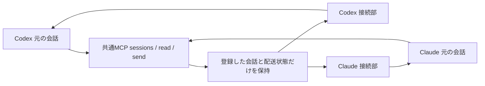

# claudex 実装計画

> 2026-10-04 に claudex から seamless へ改名した（独立リポジトリ）。本文の claudex、`~/.claudex`、実行したコマンドは記録当時の旧名のまま残す。

更新: 2026-10-01 JST
対象: 同じMacで稼働する、本人が登録したCodexとClaude Codeの会話。
状態: CLI実会話17項目、追加の境界観測7項目、既存Desktopの相互読取りと両方向配送を反映。Grok独立再判定APPROVE。今回の方式検証と実装計画は完了。
本計画は製品化の計画。試験用の固定IDやPIDを本体へ流用しない。

## 決定

**共通MCP窓口と、元の会話への直接接続を組み合わせる。** MCPは、両製品が共通の道具を呼ぶための接続方式。道具は `sessions`、`read`、`send` の3つに絞る。

本人は「Claudeの設計会話を読んで疑問点を送って」と依頼する。Codexが会話を選び、本文を読み、そのClaude会話へ送る。Claudeは元の文脈で返す。逆方向も同じになる。IDや配送用ファイルを本人に操作させない。

純正一覧や純正SendMessageを他社セッションへ差し替える拡張点は、調べた版で確認できなかった。追加する3つの道具が自然言語から選ばれる方式を採る。両実モデルが共通MCPを選び、相手の実履歴を読んだことは検証済み。

agmsgはforkしない。製品ごとの接続部を分ける発想と、元の実行体へ届ける方式を採る。新しい共通受信箱やSQLiteは作らない。

## 実測によって変更した設計

| 発見 | 実装に反映すること |
|---|---|
| Codexのephemeral=trueはincludeTurnsを拒否する | 本文を読む対象は通常の保存される会話。ephemeralはread不可と明示 |
| 両方向のMCP readが元の会話を読めた | 会話のコピーを作らず、各製品の読取機能を呼ぶ |
| Codexは返信を現在のturnへ取り込む場合がある | 1依頼=1turnと仮定しない。message_idで追跡し、既に観測した完了も照合 |
| 両製品ともhold完了後にpeer文を扱えた | busy中は純正の待機処理に任せる。既存処理を中断する操作を呼ばない |
| Claudeのbusy入力はqueued_command attachmentに保存される | SDKのuser/assistantだけで完了としない。版を照合した読取部でpeer記録を補う |
| Codexへ同じmessage_idを2度送ると2turnが実行された | 共通窓口で書込み前に重複を止める。native側の重複排除に依存しない |
| 停止したClaudeのsocketへの送信は失敗した | 消えた接続はoffline。別プロセスを起動して同じ会話に見せない |
| 既存Codex Desktopのownerへ直接配送できた | Desktop接続部を作る。ただし内部IPCなので、版と接続形を毎回検査 |
| Claude Desktopがpeer表示と元のmarkerで応答した | Desktop同梱Codeも独立した版として受入試験する |
| 接続だけでは応答ルールが伝わらない | 登録時に外部依頼の扱いを説明する。人間の承認と混同しない |

通信の確認は、毎回生成する受信確認用の乱数とmessage_idで行う。相手が以前から知っている固定文字列だけの一致を、受信の最終証拠に使わない。

## 構成と正本

会話本文の正本は元製品に残る。中継が保持するのは接続情報、依頼の識別子、返信先、現在の配送状態。取得した本文はその呼出しの返却に使い、履歴DBへ保存しない。

同じMac内のプロセス間接続を使う。試作のlocalhost HTTPは製品の外向きAPIにしない。本体は所有者を照合したUnix socketと、接続ごとの推測できない資格情報を使う。モデルが `from` や接続先socketを引数で指定することはできない。

readOnlyのMCP注釈は実際に読取だけの道具へ付ける。sendをreadOnlyと偽装しない。Codexをread-only / approvalPolicy=neverにし、MCPにreadOnly注釈を付けなかった試験ではreadが拒否された。この組合せの観測であり、never単独の一般則にしない。登録時に純正承認方式を照合し、拒否された呼出しを成功表示しない。

短い監査記録には、時刻、接続世代、message_id、送り主、宛先、結果だけを残す。本文、認証値、思考内容は記録しない。監査は受信箱でも会話の正本でもない。

## 共通データと道具

会話識別子は `{provider, host, native_session_id, runtime_generation}`。表示名は別属性。接続ごとに `read`、`send`、履歴の範囲、許可された相手を固定する。PID単独は使い回されるため、起動時刻とnative側の会話IDも照合する。

| 道具 | 入力 | 返却 | 必須処理 |
|---|---|---|---|
| sessions | 名前やプロジェクトの絞込み | 登録済み会話、稼働状態、read/send可否、制約 | 未登録本文を読まない。重名は区別して返す |
| read | target、cursor、limit | 元ID、user/assistant/peer、可視本文、出典、取得時刻、次cursor | 存在と接続世代を先に照合。空会話と不存在を分離 |
| send | target、text、message_id、reply_to任意 | 同じmessage_id、観測した配送段階 | senderは接続資格から確定。書込み前の重複検査、返信先の認可 |

`message_id` は送り側クライアントが呼出し前に生成する。同じIDの再呼出しは既存の結果を返し、再配送しない。同じIDで本文や宛先が違う場合は衝突として拒否する。

本文の形式は、userとassistantの可視テキスト、それにpeerの可視テキストと由来に限定する。画像、音声、添付実体、全tool結果の相互変換は初版に含めない。省略を返却metadataに記す。思考や署名を出さない。

返信にもsendを使う。`reply_to` は受信した依頼への対応を示す。replyを新しいrequestとして自動処理しない。受信した文が終了や追加送信を命じても、登録された処理範囲と人間の承認境界を変えない。

## 製品ごとの接続部

### Codex

CLIの管理下で起動した会話は、所有app-serverへの `thread/read(includeTurns=true)` と `turn/start(input=[], toolOutput=...)` を使う。本文取得後も元のmessage IDを返す。peerはfunctionCallOutputとして返却する。

既存Desktopは、実際にその会話を所有するDesktop IPCへ接続する。initializeで独自clientTypeを名乗り、owner discoveryで所有者を照合する。独自namespaceのtoolOutputを渡し、model、effort、cwd、permissionsは上書きしない。

別のapp-serverで既存IDをresumeする方式は採らない。予約clientType、予約namespace、MCPアプリの発信元偽装も使わない。読取りは会話を指定したfollower登録でownerのsnapshotを取得し、必要な可視項目だけをメモリ内で取り出す。取得後はfollowing=falseを送り、接続を閉じる。全snapshotをログに保存しない。元の会話ID、owner、revision、元item IDを照合する。全履歴が必要ならthread-follower-load-complete-historyを呼び、返却revision以降のsnapshotを待つ。全履歴ロードも実測済み。要求の返却revisionとsnapshot revisionの一致、canonicalIsComplete=true、turnsHaveLoadedOldest=trueを確認した。個別turnのpaginationは8件とも欠測。欠測を保持したうえで、Desktop 26.928.31416 build12553のnative完了条件に一致したことを確認した。明示falseは未完了とし、この欠測の扱いは確認済みの版だけに限定する。ACKより先にsnapshotが来る場合があるため、ロードACK後のsnapshot refreshを明示手順にする。

Desktop IPCは公開された安定SDKではない。対応版を固定し、不一致時はsendを無効にして理由を表示する。更新で壊れた際にuser入力へ自動変換しない。

CLIの共通MCP呼出しと、Desktopの接続部は別々に実証した。Desktop試験では同じ接続部を固定Pythonコマンドとして呼び、通常の権限確認を残した。完成版ではこの操作を共通MCPへ組み込み、対応する登録済み会話の操作だけを初回設定する。今回グローバルMCP設定への導入は行っていない。

### Claude Code

登録時にSessionStartが示す受信socketを取得する。DesktopはUI会話ID、native session ID、子プロセス、socketの対応を照合する。対象の純正peer socketへ送る。socket書込み成功は受信完了としない。

本文は公式SDK `get_session_messages` で取得する。busy時のpeer attachmentはSDKが通常メッセージとして返さないため、登録済みの正本ファイルだけを読む補助部で補う。補助部はsession ID、型、出典を照合し、許可した可視フィールドだけを返す。

元のClaude履歴を書き換えたり、外部会話をClaudeの履歴形式で複製したりしない。CLI版とDesktop同梱版は別に検査する。

## 配送状態と異常時

| 状態 | 根拠 |
|---|---|
| accepted | 窓口が認可と重複検査を終え、依頼を受理 |
| submitted | native接続への書込みが成功。まだモデル受信とは言わない |
| observed | 相手側native記録、または対象messageの受信を確認 |
| replied | 認可された相手からreply_to付き返信を確認 |
| rejected / offline | 送信前の拒否、または停止を確認 |
| unknown | 書込み後のtimeout、接続断、配送状態の消失 |

turn完了だけで個別messageの処理完了にしない。Codexは一つのturnに複数messageを取り込む。Claudeはbusy入力を別の保存型で残す。両者ともmessage_idを起点に対応付ける。

中継停止後に過去の依頼を自動で再送しない。再接続には新しい接続世代を発行する。古い世代の依頼はunknownとして照会だけ許可する。復旧後も自動処理を継続する耐久キューは初版に含めない。

送信時の接続世代を固定し、読み込んだPIDが別の会話へ変わっていたら拒否する。登録消失や取得失敗を「本文0件」と偽装しない。

## 権限と対応範囲

送り主の識別はclaudexの登録接続に基づく。純正製品が他社セッションを認証したことにはならない。ClaudeのpeerラベルやCodexのtoolOutput分類も、人間の承認を与えるものではない。supportsUntrustedAppInputは別の入力経路の能力表示であり、toolOutput送信の認可条件には使わない。

受信会話が既に許可されている範囲の質問、読取り、応答を扱う。相手からの文だけで権限、モデル、設定、承認待ちを変更しない。試験のNO_AUTH回答は、その固定条件の観測であり、任意の攻撃文への保証ではない。

最初に導入する単位は登録した会話のペア。全履歴の横断公開、別Mac、クラウド会話、Claude Chat/Cowork、fork、pause、モデル切替、公開送信は初版の対象外。

## 実装の順序

| 順序 | 作るもの / 主なファイル | 前提 | 完了条件 |
|---|---|---|---|
| 1 | `src/protocol.ts`, `src/registry.ts`, `src/cli.ts` | 実測schema | 会話の登録、世代、可否を表示。未登録、重名、PID再利用を区別 |
| 2 | `src/adapters/codex.ts`, `claude.ts`, `read.ts` | 1 | 元IDとpeer由来を保持した相互read。上限とcursor、空/不存在を試験 |
| 3 | `src/delivery.ts`, `src/mcp.ts` | 1,2 | 両モデル起点の往復。受信者の事前文脈にない乱数とmessage_idが一致 |
| 4 | `src/adapters/codex-desktop.ts`, `claude-desktop.ts` | 3 | 元のUI会話へ接続し、元ID/PID/設定を保持。版不一致はunsupported |
| 5 | 登録手順、受信契約、表示、解除手順 | 1–4 | 本人が自然言語だけで相手を読み、送信と返信を確認できる |
| 6 | `tests/e2e`, 版互換試験、独立レビュー | 1–5 | 下記の製品受入条件すべてと別家系のAPPROVE |

言語はTypeScriptを推奨する。共通MCPの実装とCodexの生成型を同じ言語で扱えるため。Claude SDKの参照試験はPythonで残す。試験のPython coordinatorや固定fixtureのIDを本体の運用経路にしない。

配送のwrite経路は `delivery.ts` 一つに集約する。Desktop接続部やMCPから直接native writeしない。最初から重複と認可が通る構造にする。

## 製品実装後の受入条件

これは実装予定コードの検収であり、今回の方式検証の未実施を言い換えた一覧ではない。

1. 起動済みの対象会話を登録し、両モデルがsessions/read/sendを選べる。
2. 読取りは元ID、出典、peer由来を保持。上限、続きの取得、空、不存在、接続世代を区別する。
3. 両方向のrequest/replyが、同じ会話とプロセスへ届く。受信側の未知乱数とmessage_idを照合する。
4. busy時に進行中の処理が完了する。1turnへ複数messageが届いても取り違えない。
5. 重複IDの再呼出し、同ID別本文、別sender、他者reply_to、旧接続世代を拒否する。
6. native停止、中継停止、送信前後の切断を区別。unknownの自動再送は0回。
7. 送り主の文言では接続資格や承認状態を変更できない。権限を超えた依頼は元の承認経路に従う。
8. 本文、思考、認証値を中継の永続記録へ保存しない。元の会話にある履歴はそのまま残る。
9. 対応するDesktopの通常画面で受信を確認。更新版の不一致時は説明付きで無効化する。
10. 独立レビューの重大指摘0件。実試験終了コードと判定を別に記録する。

## 導入と後戻り

接続を解除すれば、元の会話と純正機能は残る。初版の導入時は対象会話だけ登録する。ユーザー共通のMCPやskillの配布はCJ-Pluginのwire経路に従う。検証コードからグローバル設定へ直接書かない。

耐久配送、常駐監視、別Mac接続は後続。支払期日は、複数日を跨ぐ依頼の自動継続を製品要件に追加した時点。その時も会話本文の共有DB化を前提にしない。

本人が押さえる判断は、共通の道具を3つ足す体験と、版を固定したDesktop接続を採ること。接続形式や型の差は実装側で吸収する。

## 2026-10-02 相手探索の具体化

本人の概ねOKとteam-plan/team-build指定を受け、P1の登録名簿、Git作業場所、担当、候補選択、宛先再照合を specs/202610-session-discovery/ に具体化。Codex→ClaudeとClaude→Codexは同じ処理。P1完成をP2以降の通信製品完成へ読み替えない。

## 2026-10-02 製品実装で確定した差分

今回の製品は登録された同じMacのペア向けのCLI持続serveとstdio MCP。Codex Desktopのsnapshot、Claudeの元履歴ファイルから可視項目を読む。Claude公式SDKを製品の必須依存にせず、版を照合した元履歴読取部に統合した。思考や認証値は投影しない。native送信先の世代、cwd、所有者を実観測し、登録上の双方向許可を照合する。caller引数は同じOSユーザー内の登録選択であり、独立した暗号認証は提供しない。

配送状態の返却はsubmitted/unknown/rejected等。observedとrepliedは相手の元会話をreadして依頼IDとreplyToを照合する。専用の状態照会APIや常駐処理は初版へ追加しない。

再起動と並行起動で二重writeしないため、本文なしのhash/status/時刻を~/.claudex/reservationsへ送信前に原子的に予約する。同じ元会話IDと依頼IDで再配送しない。過去submittedの返却は保存済みの提出結果であり、新しい世代への配送成功を表さない。pending/unknownは自動再送しない。耐久配送キューは作らない。

Claudeのbusy記録だけでなくidle時の純正peer包みも読む。origin.kind=peer、固定見出し、1行のenvelope、元uuid一致を要件とし、通常user本文をpeerへ昇格しない。返信への返信はinvalid_replyとし、初版は1依頼と1回答の相関に絞る。続ける場合は新しい依頼として本人の指示範囲内で送る。
