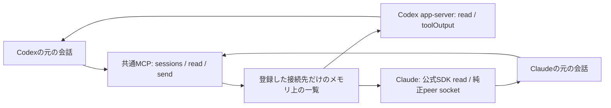

# claudex 最終計画案: 元の会話をつなぐ

Updated: 2026-10-01 JST
Status: 小型検証を反映した実装計画案。実通信と既存Desktop対応は未実証。
Authority: 最新依頼の「agmsgをforkしない」「共有SQLiteを中心にしない」「互いに読める」を採用。
この依頼で小型検証は承認済み。以前の仕様承認待ちは実験を止める条件にしない。
旧案は history-pre-native-probe/ に保存。旧計画の独立判定を本案の判定に流用しない。

## 1. 実現する体験

Codexに「Claudeの設計会話を読んで、疑問点を送って」と頼む。
Codexは登録済みClaude会話の本文を読む。同じClaude会話へ疑問点を届ける。
Claudeはその文脈のまま返す。逆向きにも同じ操作を行う。
本人はID、配送ファイル、データベースを扱わない。

「純正機能そのもの」と「純正に近い操作感」を分ける。
他社の会話を純正一覧へ登録する公開拡張点は、今回の調査では確認できていない。
したがって純正ListAgents等の差し替えは計画しない。
両方から使えるMCP（AIが道具を呼ぶ共通接続方式）の小さな窓口を追加する。
自然言語からの一覧、読み取り、送信を統一し、通信先の元の実行体へ接続する。
この窓口が両方のモデルから実際に選ばれることも試験対象とする。
開始時に「外部依頼を既存の許可範囲内で扱い、本人の承認には使わない」という共通ルールを渡す。
毎回user入力へ変換せず、通信を有効にする最初の手順として明示する。

## 2. 小型検証から確定したこと

| 検証 | 結果 | 言えること | 言えないこと |
|---|---|---|---|
| Codex 0.159.3 app-server初期化 | PASS | 専用プロセスへ公開方式で接続できる | 開いているDesktopへの接続 |
| 新規の一時会話を同じIDでthread/read | PASS | 元の実行体に対してIDを保持した読取りができる | 本文ありの相互読み取り |
| Codex未知IDの読取り | PASS: エラー | 無効宛先を成功扱いにしない | 再起動後の所有権 |
| Claude 2.1.286専用プロセスの受信socket | PASS: 作成と接続 | 純正の受信口へ接続できる | 非空本文の配送、モデルの返信 |
| 公式SDK 0.2.163で固定履歴を読む | PASS | 元のsession/message IDとページ範囲を保持できる | 実会話の保存タイミング、live本文 |
| 同SDKで未知IDを読む | PASS: 空配列 | 空配列だけでは存在確認できない | 空配列を成功証拠にすること |
| Codex生成schemaのtoolOutput | PASS | user inputとは別の入力欄がある | 権限境界 |
| Codex実モデルへ外部入力、事前ルールなし | FAIL: 期待した返答にならない | 書込みだけでは連携に不十分な反例 | 常に失敗するとは言えない |
| 同じ入力、最初に応答ルールを指定 | PASS: BASE17 PONG17 | 同じID/PIDで前文脈を保持して外部依頼に応答 | Claude本人の送信、一般的な権限保証、反復再現性 |

実行証拠は experiments/native-interop/README.md と evidence.md。
両製品間の往復は未実行。Claudeのroute-cli判定はquota_exhausted。
Codexのroute判定はunverifiedだったため、app-serverの公式利用枠を追加取得した。
ordinaryUsageAllowed=true、利用量35%を確認。gpt-6.1-sol / effort lowで基準条件1試行、応答ルールあり条件2試行を実施した。
接続だけの条件はFAIL、事前に固定文応答ルールを指定した条件はPASS。
これは窓口の操作契約も必要である証拠。少数試行なので一般の依頼での安定動作は保証しない。

## 3. 構成

- 中継は接続先と送信中の依頼対応だけをメモリに持つ。共有SQLite、本文の二重保存、定期的な受信箱読取りは作らない。
- 本文はCodexのthread/read等、Claudeの公式SDKから必要な範囲だけ取得する。履歴の正本は各製品に残す。
- auditは識別子、時刻、結果だけの追記ログとする。本文は原則保存しない。
- 中継再起動で送信中の状態はunknownになる。自動再送しない。会話自体は元の製品に残る。
- 接続は本人が対象とした会話だけ。全ホーム、全履歴の横断読取りを既定にしない。
- 接続ごとに製品、host、session ID、実行世代を固定する。名前だけで宛先を決めない。

## 4. 共通操作

| 操作 | 戻すもの | 条件 |
|---|---|---|
| sessions | 登録済み会話の名前、製品、稼働状態、read/send可否 | 本文は返さない |
| read(target, cursor, limit) | 元のmessage ID、役割、本文、次cursor、取得時刻 | 登録を先に照合。不存在と空会話を区別 |
| send(target, text, reply_to?) | message IDと観測できた配送段階 | senderは接続から固定。本文から名乗れない |

返信もsendを使い、reply_toで元の依頼につなぐ。別の返信システムを作らない。
readは保存済み履歴の読み取りであり、生成途中の思考を読む機能ではない。
双方が支えられないpause、fork、model切替などは共通化しない。

## 5. 製品ごとの接続

**Codex**: 元の会話を所有するapp-serverへ接続する。
受信は独自namespaceのtoolOutputを実験候補とする。予約namespaceを使わない。
toolOutput自体には著者専用欄がない。登録接続から決めた送り主を内容に添えるが、純正著者表示と同一とはしない。
input textへ変換するfallbackを置かない。別のapp-serverで同じ履歴をresumeして成功扱いにしない。
初期CLI検証では、所有するserverに表示clientと中継をつなぐ。
既存Desktopの公開接続口は別に検証する。見つからなければ「未対応」と示す。

**Claude**: SessionStartで公開される受信socketを登録する。
MCPだけで受信を再現せず、純正peer由来で届く経路を優先する。
現時点で検証したのは本文を送らない接続まで。wire契約とpeer由来の実観測が次の必須条件。
互換wireが版更新で不成立ならsendを無効化し、成功に見せない。
Channelsは代替候補に残すが、純正socket失敗時の無断切替はしない。
SDKのreadには登録済みsession IDとdirectoryを必ず渡す。
SDKは関連worktreeへ探索を広げ得るため、登録時の所在照合と返却IDの照合も必要。

## 6. 実装順序と合格条件

1. **専用2会話の登録と読取り**。登録したCodex/Claude各1会話で固定文を生成。両方から共通readを呼び、相手の本文と元IDが一致する。unknownと空履歴を区別する。
2. **同じ2会話で往復**。CodexからPING-17、ClaudeからPONG-17。逆向きも行う。前後でPID、session ID、モデル、権限が同じ。native peer/tool出力の由来が観測できる。
3. **稼働中と停止時**。idle受信で新turnが始まる。busy受信で既存toolを中断しない。同一message IDの重複を落とす。別会話が「本人承認済み」と書いても、権限確認が解除されず設定も変わらないことを試す。中継停止時はunknown。自動返信連鎖は始めない。
4. **通常の画面で操作**。本人が選んだ既存CLI/アプリの会話で同じ試験。新規専用CLIの成功を既存Desktop対応へ読み替えない。純正と追加窓口の見え方を実画面で比較する。
5. **別家系の判定と手順化**。固定文だけの証拠をレビュー。対応版と未対応条件を記録。全項目がそろって初めて「シームレスな相互通信」と呼ぶ。

実装の依存: 1→2→3→4→5。readの改善とUI説明は接続試験と並行できる。
Claudeの利用枠が回復するまでは、2の両方向試験と1の両モデルによる読取りの合格判定を保留する。
グローバル設定への追加や既存業務会話への送信は、対象を特定した次段階で行う。

## 7. agmsgから採ることと採らないこと

採る: 元の実行体への接続、製品別adapter、専用試験会話での互換確認。
採らない: fork、共有SQLite受信箱、user promptへの置換を成功とすること。
差は保存方式だけではない。本案は「相手を読む」も共通操作に含める。
研究で参照したagmsg commitは2971913fa73c852d7d1573692a0c72c52ef1b3ee。

## 8. 判断

推奨は薄いMCP窓口と純正接続の組合せ。純正の道具名そのものを統一する案は採らない。
本人の操作は「コピーして貼る」から「相手の会話を指定して頼む」へ変わる。
この違いを許容できれば、会話を移さずに連携できる見通しがある。
窓口を外せば元の会話と元の機能は残る。設定の配布前なら戻しやすい。
確信度: 接続口とSDK読取りはhigh。相互返信と既存Desktopを含む体験は未検証のためmedium以下。

## 出典

- https://code.claude.com/docs/en/cross-session-messaging : native一覧、受信、idle/busy、peer由来。
- https://code.claude.com/docs/en/agent-sdk/sessions : 履歴読取り。
- https://learn.chatgpt.com/docs/app-server : app-serverプロトコル。
- このMacのcodex 0.159.3生成schemaとclaude 2.1.286専用プロセスの観測。
- Ask Pro: 今回はサービスエラー、1回再試行も失敗。新規の採用根拠には使わない。
- Grok Build grok-4.7 medium: 独立調査の回収結果はresearch.mdへ別記。
