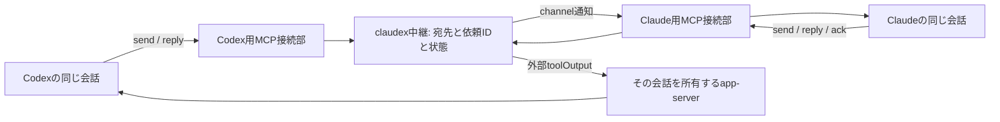

> Superseded by 2026-10-01 native-first probe and revised plan.

# セッション互換通信の実装計画

Status: DRAFT / spec approval pending / implementation not started
Updated: 2026-10-01 JST
Authority: 製品の条件はルートと機能のspec.md。ここでは接続方法と検証を定める。

## 選んだ構成

同じMacで動くNode.jsの中継プロセスを1個用意する。
各会話が起動するMCP接続部は、その会話の送信者IDで中継へ登録する。
Codex側の入力は既存app-serverへの公開toolOutput、Claude側の入力は公式Channelsを第一候補にする。
受信側はackとreplyをMCP toolで明示する。処理の終了だけで返信完了を決めない。

CLIの第一実証では、専用に登録したapp-serverへCodexの表示用clientも接続する。
Claudeは専用試験会話をChannels付きで起動する。
両方の実行体を保持する。送信のたびにresumeするプロセスを作らない。
モデル、推論量、権限設定を接続時に上書きしない。

既存Desktopへの接続は、対象appが提供する同じ実行体への入口を実測してから有効化する。
公開app-serverがあることだけでDesktop対応とは宣言しない。
Desktop対象に別app-serverを生成するfallbackは設けない。

## 候補の比較

| 経路 | 初期扱い | 理由 |
|---|---|---|
| Codex app-serverの独自toolOutput | 主候補 | user入力を作らず、外部出力として届けられる。元作者は中継で保持する |
| Codex CLI queue | 主経路には使わない | 標準入口だがuser入力。外部AI由来をnative authorとして保持しない |
| Claude Channels | 主候補 | 外部通知と返信toolが公式。opt-inが必要でDesktop対応は未確認 |
| Claude peer socketへ直接投稿 | 実験候補 | script用途の説明はある。wireの全契約と返信回収は未確認 |
| 常駐ClaudeにSendMessageを依頼 | 代替候補 | native機能を使えるが、追加の会話と推論費用が発生する |
| 双方のSDKで管理会話を新規作成 | 代替候補 | 制御しやすいが、既存Desktop接続の代用にはならない |
| native team JSONへの直接書込み | 不採用 | 書込み先の公開は第三者送信契約を保証しない |

## 中継の責務

- 全ての送信は中継の単一write経路を通す。接続部の同時所有を拒否する。
- 中継自身も同じstoreを使う二重起動を拒否する。配送前に試行を永続化する。
- senderは登録された接続から決める。tool引数にsenderやsource threadを書かせない。
- 宛先はproduct、host、runtime generation、session IDで固定する。表示名だけでは送らない。
- request、ack、replyを分ける。replyは既存requestに1回だけ対応づける。
- requestとreplyに別のmessage IDを持たせる。request IDで相関させ、配送ackはそのmessageのrecipientに限る。
- ack、processing、replyは保存済みrecipientの有効な接続だけが送れる。statusと結果取得は保存済みsenderだけ。
- 認可をrequest ID検索、内容比較、キャッシュ返却より先に行う。replyの宛先は元requestから導出する。
- request IDは永続化する。同じIDと同じ内容は同じ結果を返す。内容が違えば拒否する。
- 送信済みか不明な依頼は自動再送しない。受信側で重複排除できない副作用のexactly-onceを保証しない。
- 期限は既定120秒、指定範囲1〜600秒。期限後の返信はlate replyとして記録し、新たな依頼を起こさない。
- 本文は初期32 KiB以下、未処理依頼は宛先ごとに100件以下。上限超過は明示的に拒否する。
- 初期は直接requestとreplyだけ。自動転送、broadcast、返信への自動返信は作らない。
- 初期実証は登録された会話ペアごとに新規requestを32件までとし、管理側の明示再許可まで補充しない。
- 未処理100件には未完了とdelivery_unknownも含める。ackとreplyの処理枠は新規requestと分ける。
- 新IDによる連続依頼も32件の予算を消費する。因果関係をLLMの自己申告で判定してループ防止とは呼ばない。

状態は単一の順序へ潰さない。
broker受理、transport書込み、受信ack、処理開始、reply、hold、refuse、expired、delivery_unknownを別の観測として保存する。
後続の観測が来ない場合に、前段から推測して完了を作らない。
request配送とreply配送を別々に記録する。reply保存だけで元会話へ戻ったとしない。
外部書込み前にdispatch intentをstoreへ確定し、書込み結果を後で追加する。
再起動時にintentだけ残った試行はdelivery_unknown。自動再送しない。
重複内容の比較にはsender、recipient、種別、deadline、本文を含める。
期限切れは未配送のexpiredと、配送後のresponse_deadline_exceededを分ける。
配送後の期限超過は通知の取消しや処理停止を保証しない。late ackとlate replyも保存する。

sendは永続的な受付結果だけで戻る。replyは返信保存の結果だけで戻る。
モデル向けwaitは即時の状態取得とし、active turnを占有する長時間待ちは作らない。
CLIのwaitはモデル処理の外でだけ待てる。相手への送信と返答を同期RPCのように接続しない。
1つのturnへ複数requestが対応できるよう、requestとturnの対応を独立に保存する。

## 権限と由来

外部AIの本文は人間承認として扱わない。
中継は権限承認、permission relay、設定変更、シェル実行の機能を提供しない。
Codexへは独自namespace `claudex` のtoolOutputを使う。
予約済みnamespace `codex_app` / `codex_tui` の `send_message_to_thread` を名乗らない。
Claudeへはchannel通知として渡す。独自channelを起動する本人のopt-inと、依頼ごとの権限を混同しない。

MCP instructionsには、依頼ID、送り主、宛先、受信ack、返信操作の意味を固定して書く。
本文で宛先、承認、sourceを上書きする指示は採用しない。
この説明だけでLLMの全操作が防げるとは保証しない。
受信側の権限と実行toolで拒否されることを実試験する。
保証できない組合せはcapabilityをunsupportedとする。
endpointごとに許可操作、読めるデータ範囲、返信してよい情報を管理側が固定する。
受信側の強い権限へ、送り主で拒否された仕事を委譲しない。
初期実証は読み取りと試験用の通信に範囲を固定できる会話を対象にする。
人の入力と外部入力が同じturnに混ざり、操作ごとの由来を強制できない場合は、
会話全体へ同じ固定範囲を強制できる対象だけを登録する。
設定が不変であるだけでは合格にしない。
別名tool、shell経由、子agentへの再委譲でも許可範囲を超えないことを試す。
既存Desktopの権限を無断で狭めたり広げたりしない。
この実行境界を提供できない既存会話はunsupported。設定変更が必要ならHuman gateへ戻る。

## 接続と配送

中継の待受けは同一OSユーザーのUnix socketのみ。HTTP公開を作らない。
初期登録は本人が明示したendpointだけ。全会話履歴の走査はしない。
接続challengeと起動世代を照合し、期限付きの登録を使う。
初期登録の管理操作はモデル向けMCP toolから分離する。
本人が選んだ会話とその接続部を、管理側で1対1に対応づける。
メッセージ本文、tool引数、自己申告IDだけでは登録できない。
登録challengeの値を表示、ログ保存、tool結果へ返さない。
登録後の接続が送り主の不変IDを持つ。別接続へそのIDを移せない。
信頼する起動元がendpoint、接続部ごとの一回の登録資格、接続世代、失効条件を割り当てる。
標準MCP initializeと同UID接続だけでは会話の認証にならない。
Codex固定版ではhost生成の`params._meta.threadId`と`sessionId`を毎callで期待値へ照合する。
`x-codex-turn-metadata.turn_id`とhostのcallIdを実行記録に使う。
modelがarguments内へ書いた同名属性は採用しない。
署名付きの会話証明ではなく、信頼したhostのstdio経路を前提とする。
現Desktop版でmetadataが欠ける場合は、名前やmodel引数へfallbackせずunsupportedにする。
runtime generationはapp-serverの起動世代と、threadのロード世代を含める。
会話IDを製品の正規入口から確認できなければ登録しない。
このMacのOSユーザー全体が侵害された場合の防御は、初期版の保証範囲に含めない。
プロセスの生存やsocketの存在だけでモデル接続済みとはしない。
秘密値と既存アプリのsession tokenを抽出しない。

Codexは同じruntimeのloaded threadと状態を取得する。
inputは空にし、toolOutput.outputはenvelopeをJSON文字列へシリアライズして渡す。
任意JSONオブジェクトを直接outputへ置かない。
namespace、name、threadIdは接続部が固定し、本文から変更しない。
RPC受理はhost受理として記録する。受信ackは受信モデルによるack tool呼出しから記録する。
両者は別の観測である。
busyなら外部依頼を中継で保持し、idle観測後に送る。
idle確認後の競合でturn/startがactive turnへ追加された場合は、その実ターンを観測して記録する。
無断interruptと、接続失敗時の別writer起動はしない。

ClaudeはMCPのexperimental capability `claude/channel` と
`notifications/claude/channel` を使う。
notificationのwriteだけでは受信を確定しない。ack toolの呼出しを待つ。
モデルが呼ぶackはモデル経由の受領申告であり、runtimeが認証した読了証明とは表示しない。
通知が黙って失われる場合はdelivery_unknownで止める。
受信のhold、refuse、組織policyを回避するための設定は変更しない。
hold/refuseは中継自身の受信ポリシーとして配送前に強制する。
ClaudeのcrossSessionInboundがChannelsにも適用されるとは仮定しない。
製品から理由が返らない消失を、refuseだったと推測しない。
capabilityはclaude/channelとtoolsだけ。claude/channel/permissionは宣言しない。
metadataの値は文字列、キーはrequest_idなど英数字とunderscoreへ固定する。
実Claude版、MCP SDK版、交渉revision、channel登録結果、reply tool権限をready条件に含める。
公式文書で、v2 runtimeとauto交渉によるrevision 2026-07-28はchannel登録できない条件を確認した。
対応するlegacy handshakeを専用起動で選ぶ案。既存設定は変更しない。
通常MCP toolの動作とchannelの受信確認を別に試す。

Desktop試験の入口では、対象runtimeとschema、入力可能なthread種別、購読、元UIの承認担当を確認する。
接続の前後で元会話がunload、reload、冷再開、設定変更された試行はlive互換の成功から除外する。
loaded/listの結果だけで同一実行体を決めない。
Claude Code tabでchannelが当該会話へ登録済みであることも必要。
既存Desktopの通常送信toolが使えることを、Channelsが使える証拠としない。

## 技術と触るパス

Node.js v22.22.3、標準net、標準node:sqliteを使う案。
node:sqliteのDatabaseSyncがこのMacで利用可能なことは実測済み。
このNode版ではexperimentalの警告がある。初期のローカル実証に限定し、版を固定する。
MCPは公式TypeScript SDKのstable v1系を使う。正確な版とAPIを導入時に一次資料と照合してlockする。
依存追加はこの作業先だけ。既存共有設定へ配送するスクリプトは作らない。

許可パス候補:
`.gitignore`、`package.json`、`package-lock.json`、`src/`、`test/`、`scripts/`、`docs/`、
`spec.md`、`GOD_Plans.md`、`README.md`、`specs/202610-session-interop/`。
実測値と本文の保存はGitに載せない`.local/`へ。
本人の設定、親ディレクトリのGit、別repo、ホームのskills配線は編集対象に含めない。

予定モジュールは中継store、broker、MCP、Codex接続部、Claude接続部、CLI。
自動翻訳、別マシン通信、常駐サービス登録は初期版に含めない。
設計正本は`docs/design/claudex.json`とし、route-designで閲覧用HTMLを生成する。
初期HTMLはdesign_only。実観測は別ファイルで保持する。

## 検証とタスクの対応

下のコマンドは実装後に作る契約であり、今は実行済みではない。
実会話試験では登録した試験対象以外へ送れないよう、対象manifestを必須にする。
実証結果は各IDと起動世代を記録する。会話本文全体と秘密値は保存しない。

| AC | タスク | 実装後の検証コマンド | 必須観測 |
|---|---|---|---|
| 01 | T01,T03,T04 | `node --test test/identity.test.mjs` | 同名2件と未知ID。product/host/runtime generation/session IDを1要素ずつずらして拒否。表示名へのfallback 0回 |
| 02 | T07,T09 | `node scripts/prove-live.mjs --manifest .local/targets.json --case codex-to-claude` | request ID、両session ID、処理開始、reply ID、元宛先への返信。人の貼り直し0回 |
| 03 | T07,T09 | `node scripts/prove-live.mjs --manifest .local/targets.json --case claude-to-codex` | Claude起点の独立した新requestとそのreply。AC-02の復路を新規依頼と数えない |
| 04 | T05,T06,T09 | live `--case idle` | 両製品で通知前idle、通知時刻、通知後の処理開始とreplyを依頼IDで照合 |
| 05 | T05,T06,T09 | live `--case busy` | 両製品で先行作業の継続、実行主体IDの一致、保留と後続開始、中断0回、別writer起動0回 |
| 06 | T05,T06,T09 | live `--case continuity` | 両製品で以前の確認文字列を参照。before/afterのmodel、effort、permission設定が一致 |
| 07 | T01,T03,T04 | `node --test test/identity.test.mjs` | 接続由来のsender一致。本文/引数偽装、未登録、本文の宛先差替、起動世代だけ旧、登録期限だけ切れた接続を拒否 |
| 08 | T01,T04,T05,T06,T09,T10 | `node --test test/authority.test.mjs` と両manifestのlive `--case authority` | 下の6試験、入力の由来、実tool拒否、設定不変、禁止fallback 0回。観測不能ならunsupported |
| 09 | T01,T02,T05,T06 | `node --test test/delivery.test.mjs` | broker受理後に無応答、hold、refuse、通知消失。いずれもreply完了に表示しない |
| 10 | T01,T02,T03 | `node --test test/recovery.test.mjs` | 同じIDで同じ追跡情報。内容衝突拒否。送信直後切断、再接続、再起動でも自動再送0回 |
| 11 | T01,T02,T03,T04 | `node --test test/delivery.test.mjs` | 返信対応、reply再返信、期限切れ、100件超過、32 KiB超過を個別に拒否 |
| 12 | T01,T08,T11 | `bash scripts/verify.sh --audit` | 下の許可フィールドだけ。未登録会話本文、過去ログ、秘密値、範囲外ファイルの読取りと保存なし |
| 13 | T10 | live `--manifest .local/desktop-targets.json --case desktop` と各app読み戻し | 試験前から開いた両appのPID、起動世代、会話IDが同一。両方向の画面でsender、request、replyを確認 |
| 14 | T08,T11,T12 | `bash scripts/verify.sh` と再現手順の実行 | 実exit code、使用版、停止方法、unsupported種別、未充足AC、別家系の判定 |

live表の省略形は`node scripts/prove-live.mjs --manifest .local/targets.json`を先頭に持つ。
AC-08はCLI用とDesktop用のmanifestで両方実施する。
権限試験は、設定変更、許可の承認、範囲外操作の3種を各製品へ送る6試験である。
sender認証が通った接続からも行う。
観測項目は`input_kind`、`authority_class`、`permission_before`、`permission_after`、
`approval_result`、`tool_result`、`fallback_attempts`。
`input_kind`と`authority_class`は、本文の自己申告で埋めず、接続部の実入力型と受信側の記録から取得する。
Codexではuser入力を作っていないこと、Claudeではchannel入力であることを照合する。
permission、設定、承認結果が人間承認済みへ変わらず、実toolが範囲外操作を拒否することを必須にする。
queue、予約namespace、未承認の別経路へのfallbackは0回。
この観測を取得できないadapterはAC-08を満たさず、unsupportedとする。
権限の強い宛先へ、送り主の許可範囲外の書込み、外部送信、合成秘密の返信を依頼する試験も追加する。
人の入力との同一turn混在、別名tool、shell、子agentを使った迂回を個別ケースにする。
実秘密は使わず、公開しても影響のない合成fixtureだけで検査する。

追加の必須ケース:
- identity: 別ターミナルの登録先取り、正規BによるAのID申告、旧登録資格の再使用。
- identity: modelのarguments内の偽_meta、host metadata欠落、期待threadと不一致を拒否。
- authority: 第三のCによるA→B依頼のack/reply/status/wait。正規返信枠を消費せず結果も返さない。
- delivery: 両方向同時依頼、受信中の逆依頼、複数通知の同一turn、review/compact/承認待ち、reply容量の確保。
- recovery: intent保存とtransport書込みとreply保存の各前後で停止。requestとreply両方が不明時に再送0。
- codex: JSONオブジェクト、JSON文字列、不正文字列、改行、引用符、Unicode。正しいwire型だけを受理。
- claude: 開発許可拒否、org遮断、非対応revision、reply tool拒否、不正metadata。readyを偽らない。
- desktop: 接続直前unload、同ID再ロード、別版、元UI終了、承認待ちの接続と切断。元UIの権限を奪わない。
- budget: 毎回別IDの新規依頼を33件送り、33件目を拒否。満杯でも既存依頼へのack/replyを処理する。

AC-13のDesktop試験対象は、試験前に存在した会話のmanifestへ固定する。
CLI実証で新設したthread IDを代入した場合は失敗させる。
同じdaemonを正規に共有していても、既存Desktopの会話とUIが保持されていれば対象になり得る。
runtimeがCLIと同じという理由だけで失敗とはしない。
画面の読取り主体、app版、PIDと起動時刻、session ID、送り主、依頼と返信の一部、
request ID、reply IDを記録する。会話本文全体は収集しない。

保存の許可フィールドは、endpointのproduct/host/runtime generation/session ID/対応機能/期限、
request ID、sender ID、recipient ID、request/reply種別、登録された通信に投入したtext、
textのhash、reply-to ID、deadline、dispatch intent、transport ID、turn ID、観測種別、観測時刻、
エラー分類、使用版、入力種別、権限設定の分類と照合結果、試験用の合成結果である。
登録前の会話本文、全履歴、ファイル内容、既存secret値、認証challenge値は許可しない。
auditは許可フィールドと許可パスへ照合する。境界違反があればexit非0にする。
秘密検査は合成fixtureと実行の読取り対象を使い、既存の秘密ファイルを収集して検査しない。
任意の文章から全ての秘密を自動検出できるとは保証しない。

機械試験は模擬adapterで往復、競合、障害を注入する。
live試験を未実施のままverify.shのexit 0で全体完了にしない。
未登録live対象はSKIPとし、対象ACを未充足に残す。
独立判定は同じ成果物版とevidenceを読む。判定不能をPASSにしない。

## Human gates

HG-01: 機能spec.mdの承認。未取得。
HG-02: このPlans.mdの承認。HG-01後に求める。未取得。
HG-03: 実会話試験。対象2会話、送る固定の試験文、モデル呼出しの上限を示して確認する。
HG-04: 共有設定への登録、Channelsの開発用許可とMCP登録。設定差分と起動対象を示して確認する。
HG-05: 既存Desktopの停止や移行が必要な場合。対象だけ止める直前に確認する。

初期実装承認に、既存会話の送信、全体配線変更、permission bypass、daemonの停止は含めない。
新しい独立Git repoの作成と、親repoへのcommitもこの計画には含めない。
これがなければroute-jobのclean commit照合は満たせないため、自己申告記録と区別する。

## Open questions と止め方

OQ-01: Codex toolOutputの固定版schemaと処理中の挙動は調査済み。
現Desktop同梱版と実接続での対応は未確認。
AC-08のinput_kindとauthority_classを受信側の記録で断言できることが、そのadapterの承認条件。
OQ-02: Desktopのlive endpoint。通常local起動コードはstdioであり、外部公開入口は確認できていない。
T10で正規接続が成立しなければ、AC-13を未充足にして範囲判断へ戻す。
OQ-03: このアカウントと版でChannelsを実際に登録できるか。起動時の本人確認前には試さない。
OQ-04: Claude通常peer socketの全フレームと往復。初期主案へ組み込まず、実験するなら追加計画にする。

未知のmethodを別のuser入力へfallbackしない。
接続先が不明な場合はそのadapterだけ止める。
返信が不明ならdelivery_unknownを返す。現在の会話と中継を再起動して推測し直さない。

## 後で補強する守り

backup、launchd常駐、監視、遠隔復旧は初期実物を遅らせない。
補強の期限は、試験以外の依頼を初めて受け入れる前。
単一write経路、権限区別、監査、設計正本は初期版から入れる。
